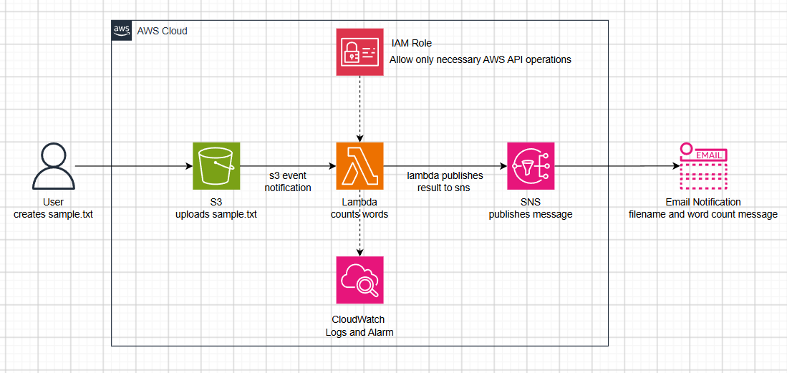

# Text file word count processor
## Project Overview
This project is my application of knowledge that I've learned during my time with the AWS Program. The application will read any uploaded `.txt` file in S3, the S3 event triggers a Lambda process and produces an output that will be pusblished to SNS and will be printed to a subscribed email, indicating the filename and word count.

## Installation and Instructions
- This installation is for python development and testing environment, not the AWS deployment.
- project uses `uv` as its project manager : `python -m pip install uv`
    - `uv sync` to install dependencies
- initiate `uv run pytest -v` to run tests

## Architecture

1. User uploads the `.txt` file
2. S3 will trigger an event 
3. Lambda receives the event and requests contents from s3 via boto3
4. Lambda process the contents and print out the filename and its word count.
5. Sumbits the information to SNS.
6. SNS sends out the info to a subscribed email to the topic.

## Features
Features — word counting, empty files, invalid inputs

An uploaded `.txt` file in an S3 bucket will be read and processed by AWS Lambda, invoking a word count process which includes an output of the word count and its filename. Then the output will be passed on to SNS and will publish a message indicating word count followed by a filename that will be produced via an email that is subscribed to that topic.

## Testing and CI
- Pytest `test_wordcount.py` and how it will behave along with five scenarios: 
    - counting words - counts words inside the file
    - an empty string - passed, words: 0
    - only whitespace - passed, words: 0
    - Only new lines and tabs - passed, words: 0
    - punctuations - if attached to another word, words: 0 but punctuation alone in itself can be counted as a word.
## Lessons Learned
- `wordcount.py`
    - The syntax `if __name__ == "__main__":` prevents the code inside of the block to run when the file is imported. Which allows `wordcount.py` defined in a module to be imported, making the function reusable.

- Pytest is a development dependency, not a application dependency. User must check pyproject.toml/uv.lock
    - development dependencies are tools you need to test, develop and verify the app.
        - To install correctly, `uv add --dev pytest` to add pytest as development dependency (linters, formatters, type checkers)
        - To revert/transfer `uv remove pytest` then add as dev dependency.
    - application dependencies are tools the app needs to run.

- Pytest doesn't guarantee everything works in CI
    - There's three things:
        1. Tests work
        2. Project can be installed and imported correctly.
        3. Project can be reproduced.
        - pytest solves tests and behaviors that they can cover, github actions can expose easily the missing dependencies, files, incorrect imports, or environment.

- `src/` stores the core codebase of the Python applicaiton. It separates application code from project files such as tests and configuration.
- `textfile_wordcount_processor/` is the actual python package. Contains modules that the application and other python code can import.
- pytest is a development tool and should be in development dependency group instead of being a part of the runtime dependency group. Pytest must be under `[dependency-groups]` in `pyproject.toml`
- `lambda_handler(event, context)`
    - `event` is the s3 event trigger notif, thats why we can see s3 bucket (name) and uploaded object (key) in that dictionary.
- Event type `PUT` is the upload method if from AWS CLI, Console, AWS SDK.  
- separate `wordcount.py` to `handler.py` to keep the handler separate from the logic.
- boto3 is the AWS SDK for Python, SDK is the language that allows users to interact with AWS services from their application code.
- if not directly communicaiton through http (upload via AWS CLI, AWS Console, SDK) event type is considered as 
### Errors and Troubleshooting
1. Started the whole project typing loose python code
    - Since I'm using `uv` as project manager, I initiated `uv init`.
2. Didn't assign `test_wordcount.py` to `tests` folder and `wordcount.py` to `src`. Upon transfering the files to their designated folders, pytest producing error.
    - changed `from wordcount import count_words` to `from textfile_wordcount_processor.wordcount import count_words`